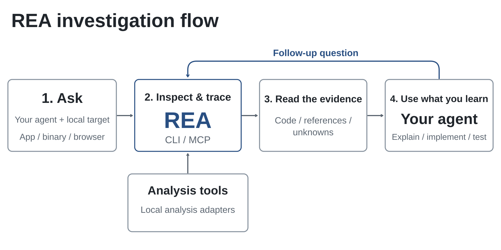
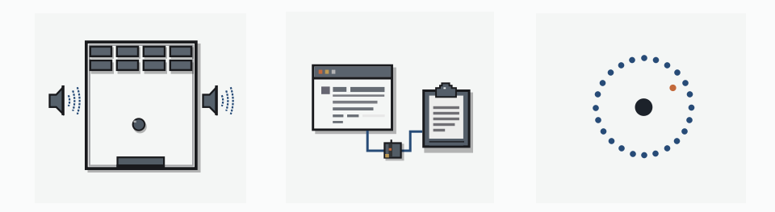

<div align="center">

**English** · [简体中文](handbook/readme/README_zh.md) · [繁體中文](handbook/readme/README_zh-TW.md) · [日本語](handbook/readme/README_ja.md) · [한국어](handbook/readme/README_ko.md) · [Türkçe](handbook/readme/README_tr.md) · [Русский](handbook/readme/README_ru.md) · [Tiếng Việt](handbook/readme/README_vi.md) · [ไทย](handbook/readme/README_th.md) · [Deutsch](handbook/readme/README_de.md) · [Español](handbook/readme/README_es.md) · [Français](handbook/readme/README_fr.md) · [Українська](handbook/readme/README_uk.md) · [Polski](handbook/readme/README_pl.md) · [Português (Brasil)](handbook/readme/README_pt-BR.md) · [العربية](handbook/readme/README_ar.md) · [فارسی](handbook/readme/README_fa.md) · [Bahasa Indonesia](handbook/readme/README_id.md) · [Italiano](handbook/readme/README_it.md)
· [Ελληνικά](handbook/readme/README_el.md) · [മലയാളം](handbook/readme/README_ml.md) · [Roman Urdu](handbook/readme/README_ur-Latn.md) · [Română](handbook/readme/README_ro.md)

# REA: Reverse Engineer Anything

### One MCP for reverse engineering across binaries, applications, and runtime behavior.

**See a feature you like. Understand how it works, down to the binary level.**

[](https://www.npmjs.com/package/rea-agents)
[](handbook/mcp-contracts.md#generated-catalog)
[](#what-you-can-analyze)
[](https://skills.sh/sudodc2/rea/reverse-engineer-anything)
[](LICENSE)
[](https://discord.gg/JUEc8rBVvC)

**[Website](https://rea.tools/) · [Guides](https://rea.tools/guides/) · [Showcases](https://rea.tools/showcase/)**

<a href="https://discord.com/invite/JUEc8rBVvC"></a>

[Quick start](#quick-start) · [How REA works](#how-rea-works) · [What you can analyze](#what-you-can-analyze) · [Showcases](#showcases) · [Build RL environments](#build-rl-environments) · [FAQ](#faq) · [Documentation](#documentation)

<code>npx rea-agents setup</code>

</div>

> [!IMPORTANT]
> Get REA from [sudodc2/rea](https://github.com/sudodc2/rea),
> [rea.tools](https://rea.tools/), or the [rea-agents npm package](https://www.npmjs.com/package/rea-agents).
> Follow the installation and release links from these official sources. A similar
> repository name or copied README does not establish that a download is official.

<div align="center">

<br />


<br /><br />

<table aria-label="REA community">
<tr>
<td align="center" width="360">
  <a href="https://discord.gg/JUEc8rBVvC">
    <br />
    <strong>Join the Reverse Engineering Community</strong>
  </a><br />
  <sub>Discord · Q&amp;A · Show and Tell</sub>
</td>
</tr>
</table>

<br />

</div>

---

See a feature in an app that you want in your own product? Ask your agent to investigate it with REA. It can inspect the app without its source code, explain how the feature works, show the evidence, and build a version for your project.

REA connects your agent to tools for inspecting native binaries, JavaScript and Electron apps, .NET assemblies, and websites. You can also use the same tools from your terminal. Analysis runs locally, and results include the evidence and limitations behind each conclusion.

Setup registers REA with your agent and installs matching workflow instructions. Native analysis can use an existing Hopper, Ghidra, IDA or Kuna installation; setup can optionally install Hopper with approval. Static JavaScript analysis needs no native analysis engine.

> **[Visit the REA website](https://rea.tools/)** for setup instructions, illustrated guides, and real case studies.

> **Community edition — Hashbrown build.** This repository is a independently
> maintained edition of REA with extended target coverage and committed
> verification evidence:
>
> - **Luau / Roblox analysis** — `lua/rea-lua.mjs`, a static inspector for
>   Luau and Lua artifacts that upstream REA does not cover: obfuscator
>   fingerprinting (VX packed bytecode, Luraph, MoonVeil, IronBrew, PSU),
>   entropy and packing metrics, executor-API surface mapping, Discord
>   webhook / remote-code reachability, and escape-decoded string samples.
>   The artifact is never executed.
> - **Committed test evidence** — `verification/TESTING.md` records the full
>   suite result (10,047 tests), the Lua fixture runner output, and real
>   artifact analyses (PE resources, JavaScript bundles) with exact commands
>   and limitations.
> - **Restructured layout** — sources live under `core/`, tests under `spec/`,
>   docs under `handbook/`, provider bridges under `provider-bridges/`, and
>   verification records under `verification/`.
>
> Upstream REA remains the reference implementation; this edition tracks its
> contracts and Evidence semantics while extending coverage.

## Quick start

On Linux, Ghidra, JADX, firmware tool launches and static JavaScript/Electron
analysis require a procps-compatible `ps` on REA's `PATH` for process ownership
checks. Recovery steps are in `handbook/installation.md` under
"Linux owned-process prerequisite".

### Set up your agent

With Node.js and npm installed, run:

```bash
npx rea-agents setup
```

Choose your agents, review the proposed changes, and approve them. Setup adds
REA's MCP server and matching workflow instructions, with backups of existing
configuration. Restart your agent afterward. Setup records the selected runtime and REA
entry script directly. If acquired through a package runner, keep its cache entry
available. Run package acquisition from a trusted directory outside the target
project. Installation and recovery details are in the setup guide below.

Setup supports Claude Code, Codex, Cursor, Gemini CLI, Grok Build and
[other agents](handbook/installation.md#supported-agents). See
[installation and setup](handbook/installation.md) for provider configuration and
manual MCP registration and Claude Code/Codex plugin installation.

MCP uses compact input schemas by default to reduce context overhead. Set
`REA_MCP_INPUT_SCHEMA_PROFILE=full` in your MCP registration when you need the
complete advertised field guidance and nested validation details. Both profiles
keep the full tool set and canonical server validation. See
"Compact input schema profile" in the MCP contracts guide.

Complete output schemas are advertised by default. If your client caps the
complete `tools/list` frame, set `REA_MCP_OUTPUT_SCHEMA_PROFILE=compact` to
bound each advertised output schema, or `off` to omit output schemas entirely.
Both settings keep canonical server-side validation and complete structured
results. See "Output schemas" in the MCP contracts guide.

### Ask your agent

```text
Understand how search works in the Notes app, show me the evidence, and build a
similar feature for my project.
```

Replace Notes with your target app and the feature you want to understand.

### Use the terminal

Inspect an extracted JavaScript/Electron app directory or ASAR:

```bash
npx -y rea-agents@latest analyze-javascript-application /absolute/path/to/app --json
```

The result includes modules, imports, Electron boundaries and their evidence.
Replace the path with your target, such as `"D:/apps/example"` on Windows.

To install the `rea` command for regular use:

```bash
npm install --global rea-agents
rea --help
```

For native analysis, configure a provider first. See the
[CLI and Evidence guide](handbook/cli.md) for native commands, provider selection,
snapshots and scripting.

### Update REA

REA changes quickly, and new releases include frequent bug fixes. Keep your
installation up to date.

For a CLI installed with `npm install --global` or `bun add --global`:

```bash
rea update
```

`rea --update` is an alias for this verified workflow and accepts the same global
output flags. Use `rea update` when combining it with other command controls.

Updater commands retain at most 4 MiB of stdout and stderr combined. Oversized
metadata replies are rejected after the command exits; verbose installs continue
with bounded diagnostics. Human progress output respects terminal backpressure
and waits for submitted writes to finish.

Bun global updates require Bun 1.2.17 or later. With an older Bun release,
upgrade Bun manually before running `rea update`.

To refresh your agent registrations and skill, run the setup command printed
by the update.

If you use `npx`, update your agent setup with:

```bash
npx rea-agents@latest setup
```

Review the setup changes and restart your agent. For one-off CLI commands,
use `npx rea-agents@latest` followed by the command. With Bun, use
`bunx rea-agents@latest` in place of `npx rea-agents@latest`.

## How REA works

Your agent calls REA through MCP to inspect the target and trace relevant code.
REA returns findings with their evidence. The agent uses them to ask follow-up
questions, explain the behavior, or write and test an implementation.
CLI commands use the same workflows.



[Open the full-size figure](web/public/assets/figures/rea-investigation-flow.svg).

<a id="current-status"></a>

## What you can analyze

REA requires Node.js 22.x (>=22.23.4), 24.x (>=24.22.1), or 26.12.1+, plus npm.
Additional tools and host support depend on the target:

| Target                  | What REA returns                                                                                                                                                       | Requirements and guide                                                                                                                        |
| ----------------------- | ---------------------------------------------------------------------------------------------------------------------------------------------------------------------- | --------------------------------------------------------------------------------------------------------------------------------------------- |
| Desktop installations   | Runtime candidates, supporting files, component markers and next probes                                                                                                | Built-in bounded directory/header inspection; [desktop applications](handbook/desktop-applications.md)                                        |
| Native binaries         | Pseudocode, assembly, strings, symbols, calls and references                                                                                                           | Hopper, Ghidra, IDA or Kuna; [native analysis](handbook/native-investigation.md)                                                              |
| Offline ELF layout      | Sections, segments, original symbols/relocations and static mitigation candidates                                                                                      | Caller-supplied pwntools on Linux x64; [binary diagnostics](handbook/binary-diagnostics.md)                                                   |
| Go binaries             | Embedded compiler version, modules, replacements and build settings                                                                                                    | Built-in static ELF/PE/thin Mach-O inspection; no Go installation required                                                                    |
| GPU code objects        | CUDA/HIP targets, selected kernel parameters and resources, retained PTX text                                                                                          | Built-in static ELF/PE/fatbin/CUBIN/PTX inspection; [GPU code objects](handbook/gpu-code-objects.md)                                          |
| Model artifacts         | GGUF / safetensors metadata, tensor declarations and derived totals                                                                                                    | Built-in header inspection; optional full-file hash; [model files](handbook/model-artifacts.md)                                               |
| IL2CPP metadata         | Unity global-metadata.dat assembly images, type and method names and index ranges                                                                                      | Built-in static decoding of versions 24, 27, 29, 31 and 39; no Unity required                                                                 |
| Godot PCK               | Archive inventory and extraction, original header/directory facts and selected content identities                                                                      | Built-in static formats 2, 3 and 4; no Godot required                                                                                         |
| Rust binaries           | Embedded cargo-auditable crate names, versions, sources and dependency edges                                                                                           | Built-in static ELF/PE/thin Mach-O inspection; [Rust binaries](handbook/rust-binaries.md)                                                     |
| PE certificates         | Authenticode WIN_CERTIFICATE entries and PKCS#7 signer/X.509 identity fields                                                                                           | Built-in static PE inspection; [PE certificates](handbook/pe-certificates.md)                                                                 |
| PE imports              | Import and delay-load DLL names, ordinals, IAT RVAs and pefile import hash                                                                                             | Built-in static PE inspection; [PE imports](handbook/pe-imports.md)                                                                           |
| ELF notes               | PT_NOTE/SHT_NOTE owners, types, GNU build-id and ABI-tag fields                                                                                                        | Built-in static ELF inspection; [ELF notes](handbook/elf-notes.md)                                                                            |
| Binary hardening        | PIE, NX, RELRO, CFG and related header flags for ELF, PE and Mach-O                                                                                                    | Built-in static header inspection; [binary hardening](handbook/binary-hardening.md)                                                           |
| Apple IPS crashes       | .ips metadata, threads, images, registers and documented crash classes                                                                                                 | Built-in static JSON inspection; [Apple IPS](handbook/apple-ips.md)                                                                           |
| Linux kernel modules    | .modinfo keys, __versions CRCs, this_module presence, and signature trailer                                                                                            | Built-in static ELF inspection; [kernel modules](handbook/kernel-modules.md)                                                                  |
| Erlang BEAM             | IFF chunks, atoms, exports, imports, lambdas and the Code header                                                                                                       | Built-in static BEAM inspection; [Erlang BEAM](handbook/erlang-beam.md)                                                                       |
| WASM artifact           | Validation, sections, exact import/export WAT forms and decoded WAT                                                                                                    | Caller-supplied WABT 1.0.42; `inspect_wasm_artifact`                                                                                          |
| EVM bytecode            | Dispatch selectors, byte offsets, inferred arguments and mutability                                                                                                    | Local raw/hex carrier on Linux x64; [offline EVM guide](handbook/evm-bytecode.md)                                                             |
| SQLite databases        | Tables, columns, indexes, views, triggers and selected ordinary-table rows                                                                                             | Local database/WAL snapshot; Node.js 24.x >=24.15 or 26+ with native SQLite limits                                                            |
| Recorded Linux crashes  | Raw notes, every recorded thread's registers/signals and optional mapping candidates                                                                                   | Caller-supplied pwntools on Linux x64; optional GDB/pwndbg; [recorded crashes](handbook/recorded-crashes.md)                                  |
| JavaScript / Electron   | Modules, imports, source maps, routes, IPC and native add-on relationships                                                                                             | Node.js and npm; Linux: procps-compatible `ps`; [application analysis](handbook/javascript-application-workflows.md)                          |
| Websites                | Page structure, scripts, network observations and requested screenshots                                                                                                | A Chrome-family browser; [browser analysis](handbook/browser-observation.md)                                                                  |
| Saved network captures  | Requests, responses, exposed payloads and source locations                                                                                                             | HAR or Fiddler Everywhere SAZ; mitmdump on Linux for native mitmproxy; [capture guide](handbook/web-network-captures.md)                      |
| .NET assemblies         | Metadata, CIL instructions, declared native dependencies and build comparisons                                                                                         | None (static only); [managed-code guide](handbook/managed-code-analysis.md)                                                                   |
| Android APKs            | Manifest declarations, classes, decompiled methods and references                                                                                                      | Headless JADX and a full JDK on Linux/macOS/Windows x64; [Android guide](handbook/android-analysis.md)                                        |
| APK signatures          | v1/v2/v3/v3.1 signers, certificate fingerprints, key rotation and digest self-consistency                                                                              | None (static only); `inspect_apk_signature`                                                                                                   |
| Android devices         | Devices, packages, processes, logs, dumps, screen captures, and APK/file transfers                                                                                     | Caller-supplied adb (emulator or hardware); [ADB guide](handbook/adb-device-analysis.md)                                                      |
| JEB projects            | Engine-backed project units, artifact digests and type/method pseudo-code                                                                                              | A caller-started JEB client serving MCP, selected with REA_JEB_MCP_URL; [JEB guide](handbook/jeb-analysis.md)                                 |
| Android resources       | Decoded manifest, string tables, locales and version facts                                                                                                             | Caller-supplied Apktool launcher; [resource guide](handbook/apktool-resource-analysis.md)                                                     |
| Flutter apps            | Dart snapshot hash, per-ABI library digests and engine build provenance                                                                                                | None (static APK parsing); [Flutter guide](handbook/flutter-analysis.md)                                                                      |
| Firmware                | Regions, extraction results and native-analysis handoffs                                                                                                               | Binwalk / Unblob on Linux; [firmware guide](handbook/firmware-analysis.md)                                                                    |
| Recorded packets        | Selected fields, repeated values, filters and decode-as rules                                                                                                          | Linux: TShark 4.x + prlimit; [capture guide](handbook/packet-captures.md)                                                                     |
| Packet summaries        | Endpoints, DNS, TLS SNI, protocol distribution and HTTP requests                                                                                                       | Caller-supplied tshark and capinfos (Linux-verified); [pcap guide](handbook/pcap-analysis.md)                                                 |
| Recorded logic signals  | Decoder annotations, sample ranges and diagnostics                                                                                                                     | Linux: sigrok-cli 0.7.2 + prlimit; [signal recordings](handbook/signal-recordings.md)                                                         |
| Packages and resources  | File inventories, digests, plists, Apple bundle anatomy and extracted resources                                                                                        | [Artifact and JavaScript guide](handbook/javascript-artifact-reconstruction.md), [Apple applications](handbook/apple-application-analysis.md) |
| Process behavior        | Terminal output, interactions, exit and filesystem observations, and run comparisons                                                                                   | Linux/macOS with a native PTY; [process capture](handbook/process-capture.md)                                                                 |
| PyInstaller executables | CArchive members, Python version, entry scripts and extracted bytecode                                                                                                 | None (static only); [Python packaged applications](handbook/python-packaged-applications.md)                                                  |
| Luau / Lua scripts      | Obfuscator fingerprints (VX, Luraph, MoonVeil, IronBrew, PSU), entropy and packing metrics, executor API surface, network/webhook reachability, decoded-string samples | None (static byte analysis); `node lua/rea-lua.mjs <file> [--json]`; [lua/README.md](lua/README.md)                                           |

Static JavaScript and .NET inspection read the supplied files without running
the application. Runtime capture runs or interacts with the selected target
using your user permissions; each runtime guide describes its effects.

For offline native-binary inspection, REA also supports caller-supplied GNU
objdump and Rizin. See the [reverse-engineering tools guide](handbook/reverse-engineering-tools.md)
for provider setup, CLI commands, and Evidence limitations. REA does not install
or update either provider.

<a id="choosing-a-deep-analysis-provider"></a>

Native formats and host support vary by provider. See
[Hopper and Ghidra setup](handbook/installation.md#hopper), the
[IDA guide](handbook/ida-provider.md) (including an optional native MCP bridge), the
[Kuna decompiler guide](handbook/kuna-provider.md), and
[experimental Windows Ghidra support](handbook/windows-ghidra-p0.md).
Ghidra also supports [16-bit DOS analysis](handbook/ghidra-dos.md).
For large binaries, raise the provider's startup deadline with
`REA_GHIDRA_STARTUP_TIMEOUT_MS` or `REA_HOPPER_STARTUP_TIMEOUT_MS`.
For provider selection, see the [CLI guide](handbook/cli.md#choose-a-provider).
Check [release availability](handbook/installation.md#released-package-and-main)
for features added since the latest npm release.

## Showcases

<a href="https://rea.tools/showcase/">
  <picture>
    <source media="(prefers-color-scheme: dark)" srcset="handbook/assets/rea-showcases-dark.svg" />
    
  </picture>
</a>

### DX-Ball: reconstruct a sound-pan calculation

Follow a sound call into its position-to-pan helper, inspect the instructions,
and turn incomplete pseudocode into C. The reconstruction passes 3,205
original-x86 cases and reproduces all 63 compiled function bytes.

[Read the case study](https://rea.tools/showcase/dx-ball/) ·
[Reconstruction repository](https://github.com/N0zoM1z0/dx-ball)

### Notion: trace the Electron clipboard bridge

Find the renderer's clipboard API, follow it through preload and IPC into the
main process, and inspect the rich clipboard format.

[Read the case study](https://rea.tools/showcase/notion/)

### TH04: recover a DOS bullet-ring calculation

Inspect the original PC-98 game's 16-bit instructions, recover the fixed and
aimed angle calculations, and compare the reconstructed C++ with the
historical compiler output.

[Read the case study](https://rea.tools/showcase/th04/) ·
[Reconstruction repository](https://github.com/N0zoM1z0/th04)

### Build RL environments with REA

Record a web app session, turn its API into tools, and export an environment an AI agent can use. Run it with AgentEnv, then add tasks and reward checks for RL training or evaluation.

[Read the guide](https://rea.tools/guides/rl-environments/) ·
[Watch the video](https://x.com/reatools/status/2112574822584918075?s=20)

If you've used REA on something interesting, we'd love to see it. Share your
case in an [issue](https://github.com/sudodc2/rea/issues) or a
[pull request](https://github.com/sudodc2/rea/pulls), including the target,
your question, how REA helped, and what you found.

## Build RL environments

Give an AI agent a local environment to practice tasks such as finding an issue or creating a folder, without running the original app. Use it for reinforcement learning (RL) or to test how well an agent completes tasks.

REA turns recorded API requests and responses into tools the agent can call. The environment uses the recorded data and supports changes only when the recording confirms their effects.

With REA set up in your agent, replace the example URL and folder tasks below with your own:

```text
Use REA to build an RL environment from my test web app at
http://127.0.0.1:3000.
Cover listing, creating, renaming, and deleting folders. You may create and
remove test folders. Leave existing data unchanged.
Save it in a folder named my-env. Check which operations work and tell me
how to run it.
```

<details>
<summary>Use the command line instead</summary>

Use these commands if you already have a file containing the app’s recorded browser requests and responses. Running the result also requires AgentEnv and Docker.

```sh
rea environment-build ./session.har ./my-env --name my-env --json
agent-env run ./my-env
```

</details>

REA exports a runnable environment with a basic test to check that it starts and responds. Use it with your RL framework to define task goals, add reward checks, and run training.

[Build an environment](https://rea.tools/guides/rl-environments/) ·
[Environment reference](handbook/agent-environments.md) ·
[Watch the demo on X](https://x.com/reatools/status/2112574822584918075?s=20)

## FAQ

<details>
<summary><strong>Which agents can use REA?</strong></summary>

Any agent that supports local MCP servers. Setup configures the
[supported agents](handbook/installation.md#supported-agents); other clients can use
[manual MCP registration](handbook/installation.md#mcp-registry).

</details>

<details>
<summary><strong>Do I need a native analysis engine?</strong></summary>

Deep native analysis uses Hopper, Ghidra, IDA or Kuna, depending on the target
and operation. Static JavaScript and .NET inspection work without a native
analysis engine. Setup can install Hopper after approval; Ghidra, IDA and Kuna
use your existing installations. See [provider setup](handbook/installation.md#hopper)
for the options and their supported targets.

</details>

<details>
<summary><strong>Do I need to start Hopper first?</strong></summary>

REA starts Hopper when an operation needs it. On macOS, a first-run dialog may
ask you to choose demo mode or activate your license. Complete that prompt in the
same user session before your first CLI/MCP operation or unattended job. Open
Hopper manually if needed. See
[Hopper startup and troubleshooting](handbook/installation.md#launcher-paths-and-troubleshooting).

</details>

<details>
<summary><strong>What does installing the skill from skills.sh do?</strong></summary>

The skill supplies investigation instructions for your agent. Use `npx rea-agents setup`
to register REA's MCP server and install the matching instructions, then restart
your agent. See [skill-only installation](handbook/installation.md#skill-only-installation).

</details>

<details>
<summary><strong>What code does REA return?</strong></summary>

Native analysis returns pseudocode and assembly. JavaScript/Electron analysis
recovers modules and their relationships. Your agent uses these findings to
write and test an implementation; the [showcases](#showcases) give worked examples.

</details>

<details>
<summary><strong>Does REA upload my app?</strong></summary>

REA analyzes targets locally. Your agent receives the tool results, and its
model provider has its own data policy.

</details>

<details>
<summary><strong>What should I do if I hit a bug?</strong></summary>

Update first; a recent release may already fix it.

For a CLI installed with `npm install --global` or `bun add --global`:

```bash
rea update
```

For agent setup through `npx`:

```bash
npx rea-agents@latest setup
```

If you're using an agent, complete the [setup refresh](#update-rea) and restart
it. Retry the same task. If the problem persists, [open an issue](https://github.com/sudodc2/rea/issues)
with your REA version, target type, steps to reproduce and error output.

</details>

## Documentation

Start with the website's [worked guides](https://rea.tools/guides/).
For exact options, prerequisites and result contracts:

- [Installation and setup](handbook/installation.md): agent registration, provider configuration, updates and uninstall.
- [Readiness and troubleshooting](handbook/installation.md#check-readiness-for-your-task): diagnose one agent or analysis engine.
- [CLI and Evidence](handbook/cli.md): commands, provider selection, snapshots, import/export and exit statuses.
- [MCP contracts](handbook/mcp-contracts.md) and [agent prompts](handbook/mcp-prompts.md): tool results, sessions and guided investigations.
- [Tool catalog](handbook/mcp-contracts.md#generated-catalog): generated inventory of tools, providers and CLI commands.
- [Roadmap](handbook/roadmap.md): planned work and capability trackers.

Report vulnerabilities through [SECURITY.md](SECURITY.md).

## Credits

REA was created by [morluto](https://github.com/morluto). This repository is a
community-maintained build by **Hashbrown** ([sudodc2](https://github.com/sudodc2)):
it adds Luau/Roblox artifact analysis (`lua/rea-lua.mjs`), republishes the
upstream project with our Discord community link, and ships verified test
evidence under [`verification/`](verification/TESTING.md). All upstream licensing terms
apply — see [LICENSE](LICENSE) and [NOTICE](NOTICE) where present.

## Disclaimer

See [DISCLAIMER.md](DISCLAIMER.md) for responsible-use guidance.

The project's position on illegal or unauthorized use covers all REA versions,
distribution channels, and platforms; each copy retains its applicable licenses.

REA is for lawful research, education, interoperability, software preservation,
and analysis of software you own or are authorized to examine.

## Contributing

We'd love your help with REA! [Open an issue](https://github.com/sudodc2/rea/issues) to
report a bug or suggest a feature, or [send a pull request](https://github.com/sudodc2/rea/pulls)
to improve the code or docs.

See [CONTRIBUTING.md](CONTRIBUTING.md) for development setup and checks,
[testing](handbook/testing.md) for verification lanes, and the
[architecture map](handbook/architecture.mermaid) for selected layers and dependency paths.

## License

[MIT](LICENSE)

REA-authored code is licensed under MIT. Third-party material retains its own
licenses and copyright notices; see
[Third-party notices](THIRD_PARTY_NOTICES.md) for the dependency inventory,
preserved license texts, and external-tool terms.

**You must legally obtain and be authorized to use commercial tools**, including
IDA Pro / Hex-Rays decompilers, Hopper, and JEB, under their applicable
licenses. REA grants no tool license, key, or activation entitlement. Trials and
demos remain subject to vendor terms, including user, feature, automation, and
output sharing restrictions. Cracked copies, stolen keys, unauthorized key
sharing, and bypassing license restrictions are not authorized. This guidance
does not amend MIT or third-party licenses.
